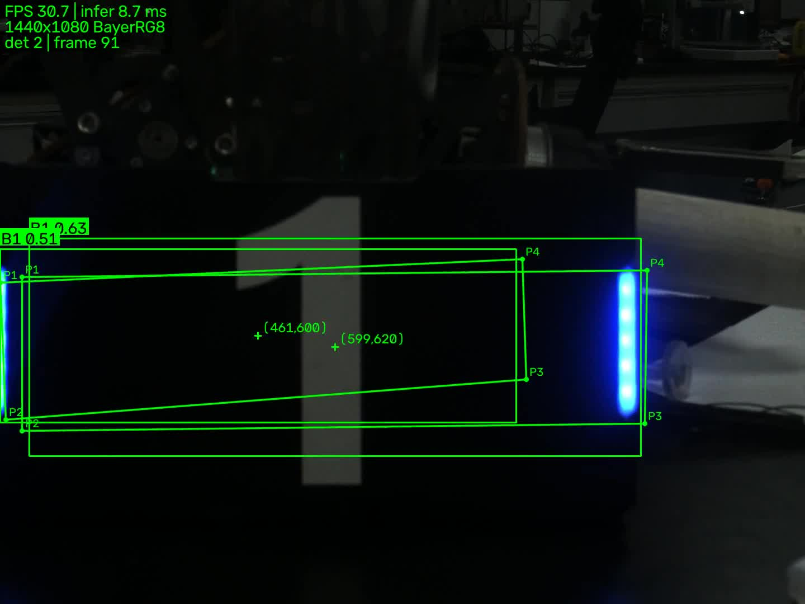

# 工业相机 + YOLO 装甲板实时识别（WSL2 / Ubuntu）

用海康机器人 MVS 工业相机实时取流，完成曝光 / 增益 / 图像格式 / 内存异常四组实验，
再把画面送进课程提供的 YOLO 权重做实时装甲板识别。

**处理链路：**

```
工业相机 ──USB3.0 Vision──> WSL2 Ubuntu ──MVS SDK──> 原始帧（BayerRG8）
                                                       │
                                         Bayer→BGR 转换（SDK 或 OpenCV）
                                                       │
                                              YOLO26n-pose 推理
                                                       │
                            画框 + 类别 + 置信度 + 关键点 + 中心点 + FPS
                                                       │
                                              窗口显示 / 录制 mp4
```

## 1. 实验环境

| 项目 | 内容 |
| --- | --- |
| 操作系统 | Ubuntu 22.04.5 LTS（WSL2，内核 `6.18.33.2-microsoft-standard-WSL2`）+ Windows 11 |
| 相机型号 | **MV-CA016-10UC**（海康机器人，1.6 MP，Sony IMX273，全局快门，彩色） |
| 相机序列号 | **L28498186**（设备枚举显示 `00L28498186`） |
| 相机固件 | **V1.6.3 201222 551351** |
| 相机接口 | **USB3.0 Vision**，经 `usbipd-win 5.3.0` 挂进 WSL |
| 分辨率 / ROI | **1440×1080（全幅）** |
| 镜头 | 8 mm F2.8（6 MP） |
| 光源 | 实验室照明（详见实验记录第 0 节） |
| MVS | 5.1.1（Linux x86_64，`/opt/MVS`） |
| OpenCV | 5.0.0 |
| Python / PyTorch / ultralytics | 3.10.12 / 2.11.0+cu128 / 8.4.175 |
| GPU | NVIDIA GeForce RTX 5060 Laptop（8 GB） |
| 模型权重 | `weights/best.pt`（YOLO26n-pose，6 类 `B1 B2 B3 R1 R2 R3`，4 关键点） |

## 2. 目录结构

```
.
├── src/
│   ├── mvs_camera.py     # 相机封装：枚举/打开/参数/取流/转换/释放
│   ├── render.py         # 画框、类别、置信度、关键点、HUD
│   ├── app.py            # 实时识别主程序（相机 / 视频 / 合成画面）
│   └── lab.py            # 六组实验的命令行入口
├── tools/probe_env.sh    # 环境自检
├── docs/
│   ├── 实验记录.md        # 实验记录（提交物）
│   └── logs/             # 从 runs/ 复制过来的异常日志
├── weights/              # best.pt（不入库）
├── data/                 # 测试视频（不入库）
├── runs/                 # 实验产物：图片、CSV、日志、录像（不入库）
└── assets/               # README 用截图（入库）
```

## 3. 运行方法

```bash
# 0) 环境自检
bash tools/probe_env.sh
python src/lab.py env

# 1) 相机接入 WSL（Windows 管理员 PowerShell）
#    usbipd bind --busid 2-18
#    usbipd attach --wsl Ubuntu-22.04 --busid 2-18
#    WSL 内：
sudo chmod -R a+rw /dev/bus/usb

# 2) 确认相机 + 抓一张图
python src/lab.py check

# 3) 实时识别（显示 + 录像 + 统计）
python src/app.py --source mvs --exposure 3000 --gain 20 \
    --record runs/demo_realtime.mp4 --stats runs/demo_realtime.json

# 4) 没有相机时用视频文件跑同一套链路
python src/app.py --source video --video data/armor_raw.mp4 \
    --no-display --record runs/dryrun.mp4 --max-frames 300
```

`src/app.py` 常用参数：

| 参数 | 说明 |
| --- | --- |
| `--source mvs/video/test` | 真实相机 / 视频文件 / 合成画面 |
| `--exposure` `--gain` | 曝光（μs）、增益（dB）；本机增益上限 17 dB |
| `--pixel-format` | 相机原生格式：`BayerRG8` / `BGR8` / `Mono8` |
| `--convert sdk/cv2` | Bayer→BGR 用 SDK 还是 OpenCV |
| `--imgsz` `--conf` `--device` `--half` | 推理参数 |
| `--record` `--record-fps` | 结果视频 |
| `--display/--no-display` | 是否弹窗 |
| `--warmup` | 正式统计前的推理预热次数（默认 3） |

## 4. 实验命令

| 实验 | 命令 | 产物 |
| --- | --- | --- |
| 曝光 | `python src/lab.py exposure --values 500,1000,3000 --tag still --gain 0` | `runs/exp1_exposure/still/` |
| 曝光（运动） | `python src/lab.py exposure --values 500,1000,3000 --tag moving --gain 0 --frames 40` | `runs/exp1_exposure/moving/` |
| 增益 | `python src/lab.py gain --values 0,6,12,20 --exposure 1000` | `runs/exp2_gain/` |
| 格式 | `python src/lab.py format --frames 100` | `runs/exp3_format/` |
| 内存/异常 | `python src/lab.py memory --case all` | `runs/exp4_memory/` |
| 参数影响 | `python src/lab.py recognize --matrix exposure:500,1000,3000 --gain 17` | `runs/exp6_recognition/` |

> 注意：`recognize` 的输出文件名固定，跑第二个矩阵前先把上一个 `result.csv` 另存
> （仓库里保留了 `result_exposure.csv` 与 `result_gain.csv` 两份）。

## 5. 实验结果（摘要）

完整数据分析见 [`docs/实验记录.md`](docs/实验记录.md)。

### 5.1 曝光（增益 0 dB，静止）

| 曝光 | 平均灰度 | 饱和比例 | 拉普拉斯方差 |
| --- | --- | --- | --- |
| 500 μs | 3.3 | 0 | 9.6 |
| 1000 μs | 5.9 | 0 | 15.4 |
| 3000 μs | 18.0 | 0.6% | 42.5 |

运动组与静止组指标几乎一致（`lap_var` 9.63/9.72、15.40/15.85、42.49/45.71）：
本次 0.5 m/s 的移动速度下，3000 μs 只对应约 2.7 px 位移，拖影不可见。
按 `v·t` 估算，要产生 ≥10 px 拖影需要 `v ≥ 1.9 m/s`（3000 μs）或 `v ≥ 0.56 m/s`（10000 μs）。

### 5.2 增益（曝光 1000 μs）

| 增益 | 平均灰度 | 高频能量 | 饱和比例 |
| --- | --- | --- | --- |
| 0 dB | 2.1 | 0.39 | 0 |
| 6 dB | 6.9 | 0.71 | 0 |
| 12 dB | 8.3 | 0.94 | 0 |
| 17 dB | 17.3 | 1.60 | 0.3% |

### 5.3 图像格式（100 帧，30 fps）

| 模式 | 转换 | FPS | 转换耗时 | CPU | 带宽 |
| --- | --- | --- | --- | --- | --- |
| bayer_cv2 | `cv2.cvtColor` | 31.48 | 0.23 ms | 18.5% | 49.0 MB/s |
| bayer_sdk | `MV_CC_ConvertPixelTypeEx` | 31.37 | 0.90 ms | 7.6% | 48.8 MB/s |
| bgr8 | 相机直出 | 31.36 | 0.34 ms | 7.0% | 146.3 MB/s |

Bayer 带宽只有 BGR8 的 1/3；30 fps 下三者都能跑满，BGR8 的带宽瓶颈要到 60 fps 才出现。

### 5.4 实时识别

| 指标 | 数值 |
| --- | --- |
| 连续运行 | 1146 帧 / 约 45 s |
| 处理帧率 | 25.5 fps |
| 平均推理 | 约 12 ms |
| 检出率 | 1.00 |
| 平均置信度 | 0.71 |
| 类别计数 | B1: 1203，R1: 134 |



### 5.5 参数对识别的影响

| 曝光（17 dB） | 检出率 | 每帧目标 | 置信度 |
| --- | --- | --- | --- |
| 500 μs | 1.0 | 1.00 | 0.509 |
| 1000 μs | 1.0 | 1.57 | 0.458 |
| 3000 μs | 1.0 | 1.87 | 0.473 |

| 增益（3000 μs） | 检出率 | 每帧目标 | 置信度 |
| --- | --- | --- | --- |
| 0 dB | 1.0 | 1.90 | 0.509 |
| 6 dB | 1.0 | 1.47 | 0.568 |
| 12 dB | 1.0 | 1.40 | 0.563 |
| 17 dB | 1.0 | 1.73 | 0.537 |

## 6. 关键实现说明

1. **取图必须成对**：`MV_CC_GetImageBuffer()` 借、`MV_CC_FreeImageBuffer()` 还，
   放在 `try/finally` 里；漏还的后果见 `runs/exp4_memory/log_leak.txt`（缓冲池耗尽 → `MV_E_NODATA`，归还即恢复）。
2. **先复制再归还**：`ctypes.string_at` 把帧数据复制到 Python bytes 后才 `FreeImageBuffer`，避免悬空指针。
3. **只保留最新一帧**：`app.py` 用后台线程取图、队列长度 1，推理慢时丢旧帧，画面不会越跑越延迟。
4. **两种格式转换路径**：`--convert sdk` 用 `MV_CC_ConvertPixelTypeEx`（CPU 占用低），
   `--convert cv2` 用 `cv2.cvtColor`（墙钟更快），用于实验三对比。
5. **曝光/增益前先关自动**：`ExposureAuto=Off`、`GainAuto=Off`，否则手动值不生效。
6. **结果视频转 H.264**：OpenCV 只能稳定写 `mp4v`，最后用 ffmpeg 转 `yuv420p + faststart`。

## 7. 已知问题与处理

| 现象 | 原因 | 处理 |
| --- | --- | --- |
| 枚举不到相机 | 没 attach / 没 chmod | `usbipd attach`；`sudo chmod -R a+rw /dev/bus/usb` |
| `MV_CC_OpenDevice` 失败 | 相机被 MVS 或另一进程占用 | 关 MVS；`pkill -f src/` |
| 画面全黑 | 光圈关死 / 镜头盖 / 欠曝 | 光圈开到 F2.8–F4；加曝光或补光 |
| 画面偏绿/偏紫 | Bayer 排列不是 RGGB | 换 `BayerGR8/BayerGB8/BayerBG8` |
| 第一次推理特别慢 | CUDA 上下文 + cuDNN 初始化 | 正常；`--warmup` 会把它排除在统计外 |
| 帧率上不去 | 曝光超帧周期 / 带宽 / 转换慢 | 看实验三的 grab/convert 耗时定位 |

## 8. 提交物

- [x] 源码（本仓库）
- [x] 实验记录 `docs/实验记录.md`
- [x] 异常日志 `docs/logs/`
- [x] 真实相机识别视频（`runs/demo_realtime.mp4`，另附）
- [x] README（本文件）
