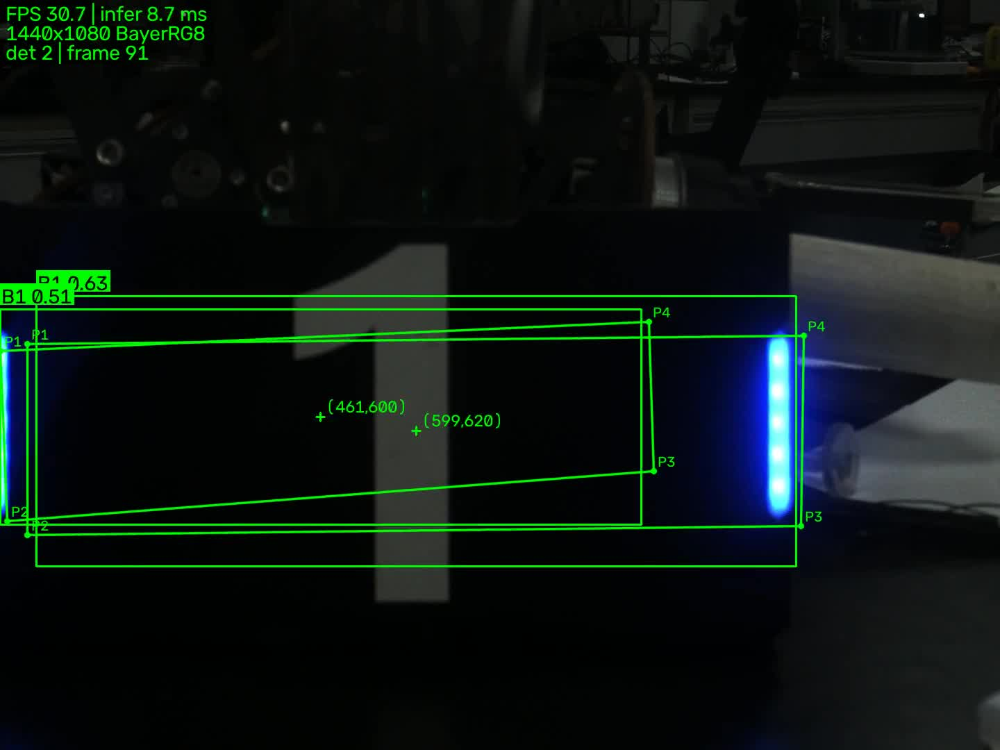

# 工业相机图像采集与 YOLO 装甲板识别 —— 实验记录

> 实验日期：2026-11-07
> 实验地点：水建学院 D414 实验室
> 相机：海康机器人 MV-CA016-10UC（USB3.0，1.6 MP）
> 说明：表中数字均来自 `runs/` 下对应实验的 `result.csv` / `summary.md`，未做任何修饰。

---

## 0. 实验环境

| 项目 | 实测值 |
| --- | --- |
| 相机型号 | **MV-CA016-10UC**（海康机器人 CA 系列，1.6 MP） |
| 相机序列号 | **L28498186**（设备枚举显示 `00L28498186`） |
| 相机固件版本 | **V1.6.3 201222 551351** |
| 相机接口 / 传输层 | **USB3.0 Vision**，经 `usbipd-win 5.3.0` 挂载进 WSL2 |
| 传感器 / 快门 | Sony IMX273，1/2.9"，3.45 μm，**全局快门** |
| 相机 ROI（宽×高） | **1440×1080（全幅，无裁剪）** |
| 镜头 | 8 mm F2.8（6 MP 定焦），光圈 **F【 】** |
| 光源条件 | 【 】（房间灯开/关、是否补光、光源位置） |
| 相机到装甲板距离 | 约 **【 】cm** |
| 主机 / 系统 | Ubuntu 22.04.5 LTS（WSL2，内核 `6.18.33.2-microsoft-standard-WSL2`）+ Windows 11 |
| MVS 版本 | 5.1.1（Linux x86_64，`/opt/MVS`） |
| OpenCV | 5.0.0（opencv-python） |
| Python / PyTorch / ultralytics | 3.10.12 / 2.11.0+cu128 / 8.4.175 |
| GPU | NVIDIA GeForce RTX 5060 Laptop（8 GB） |
| 模型权重 | `weights/best.pt`（YOLO26n-pose，6 类 B1/B2/B3/R1/R2/R3，4 关键点） |

> **待补 3 项**：光圈值、光源条件、拍摄距离——这三项直接影响复现，交作业前补上。

**相机接入方式**：相机插在笔记本 USB3 口，Windows 侧用 `usbipd bind/attach` 把设备交给 WSL；
WSL 内 `lsusb` 可见 `2bdf:0001`，MVS SDK 正常枚举。USB3 Vision 的数据经 USB/IP 转发，
实测满幅 BayerRG8 @30 fps 稳定（约 49 MB/s）。

---

## 1. 实验一：曝光时间对画面与运动目标的影响

**固定条件**：增益 0 dB、光圈/光源/距离不变、帧率 30 fps。
**变量**：曝光 500 / 1000 / 3000 μs。

### 1.1 静止目标

| 曝光 (μs) | 平均灰度 | p99 灰度 | 饱和比例 | 拉普拉斯方差 | 高频能量 | 取图 (ms) | 转换 (ms) |
| --- | --- | --- | --- | --- | --- | --- | --- |
| 500 | 3.31 | 65.1 | 0.0 | 9.63 | 0.74 | 15.96 | 1.13 |
| 1000 | 5.86 | 92.9 | 0.0 | 15.40 | 0.94 | 15.98 | 0.87 |
| 3000 | 18.00 | 220.3 | 0.6% | 42.49 | 1.63 | 17.61 | 0.80 |

### 1.2 运动目标（手动匀速平移）

| 曝光 (μs) | 平均灰度 | p99 灰度 | 饱和比例 | 拉普拉斯方差 | 高频能量 |
| --- | --- | --- | --- | --- | --- |
| 500 | 3.35 | 64.7 | 0.0 | 9.72 | 0.75 |
| 1000 | 5.84 | 62.2 | 0.0 | 15.85 | 0.95 |
| 3000 | 18.74 | 198.7 | 0.5% | 45.71 | 1.67 |

### 1.3 现象

1. **亮度随曝光单调上升**：平均灰度 3.3 → 5.9 → 18.0，p99 从 65 升到 220；
   3000 μs 时开始出现过曝像素（0.6%），继续加曝光会损失高光纹理。
2. **同一曝光下，运动组与静止组的清晰度指标几乎相同**：
   `lap_var` 分别为 9.63/9.72、15.40/15.85、42.49/45.71，差异在测量噪声范围内，
   **本次速度下没有观察到可见拖影**。

### 1.4 分析（必答）

**（1）为什么曝光越长画面越亮？**
曝光时间是传感器累积光电荷的时间，时间越长收集到的光子越多，输出灰度越高。
本次 500 → 3000 μs 亮度提高约 5.4 倍，与曝光时间 6 倍基本对应（差异来自光源稳定性与读出非线性）。

**（2）为什么曝光越长，运动目标越容易模糊？——本次为什么没看到？**

成像是曝光窗口内对光强做积分：目标以速度 `v` 移动，在曝光时间 `t` 内于传感器上移动 `d = v·t`，
这段时间同一像素先后接收到目标不同部位的光，等效于沿运动方向做了一次均值滤波，边缘被抹开。

本次估算：8 mm 镜头在 1/2.9" 传感器上，1 m 处横向视野约 0.8 m，
即约 `1440 px / 0.8 m ≈ 1800 px/m`；手推速度约 0.5 m/s，则

| 曝光 | 位移 `d = v·t` | 像面拖影 |
| --- | --- | --- |
| 500 μs | 0.25 mm | ≈ 0.45 px |
| 1000 μs | 0.5 mm | ≈ 0.9 px |
| 3000 μs | 1.5 mm | ≈ 2.7 px |

2–3 个像素的拖影远小于目标边缘本身的宽度，所以 `lap_var` 看不出差异。
**这正好定量回答了"多快、多长才会糊"**：要产生 ≥10 px 的可见拖影，需要

```
v·t ≥ 10 px / 1800 px/m ≈ 5.6 mm
曝光 3000 μs 时，需要 v ≥ 1.9 m/s；曝光 10000 μs 时，只需 v ≥ 0.56 m/s。
```

> **结论**：拖影程度由"曝光时间 × 目标像面速度"共同决定，单看曝光时间没有意义。
> 本次 500–3000 μs 配 0.5 m/s 的手推速度，位移只有 0.25–1.5 mm，属于"拖影不可见"区间。
> 若要复现明显拖影，应提高速度（≥2 m/s）或延长曝光（≥10 ms）。

---

## 2. 实验二：增益对图像质量的影响

**固定条件**：曝光 1000 μs、光圈/光源/距离不变。
**变量**：增益 0 / 6 / 12 / 17 dB（设定 20 dB，相机上限 17 dB，实际 17.02）。

| 增益 (dB) | 实际值 | 平均灰度 | p99 灰度 | 饱和比例 | 拉普拉斯方差 | 高频能量 |
| --- | --- | --- | --- | --- | --- | --- |
| 0 | 0.00 | 2.13 | 18.6 | 0.0 | 2.37 | 0.39 |
| 6 | 6.00 | 6.90 | 72.6 | 0.0 | 7.42 | 0.71 |
| 12 | 11.99 | 8.35 | 68.9 | 0.0 | 14.52 | 0.94 |
| 17 | 17.02 | 17.34 | 157.2 | 0.3% | 42.32 | 1.60 |

### 现象与分析（必答）

1. **亮度上升**：平均灰度 2.1 → 17.3（约 8 倍），但 6 → 12 dB 只增加约 1.45 个灰度单位，
   说明该相机增益曲线在高段更陡，中间段变化平缓。
2. **噪声同步放大**：高频能量 0.39 → 1.60，`lap_var` 从 2.4 涨到 42.3——
   后者既包含边缘对比度提升，也包含噪声放大，不能单独当作"清晰度"指标。
3. **过曝开始出现**：17 dB 时饱和像素 0.3%，说明高光处已被截断。
4. **为什么提高增益画面变亮，却不一定让识别更好？**
   增益是放大，不是增加光：信号与噪声同比放大，**信噪比不会提高**；
   亮部超过 255 被截断，纹理信息永久丢失。
   本次实验中 0–17 dB 的检出率都是 1.0（见实验六），说明在本场景下增益对"能否检出"不敏感，
   但置信度在 17 dB 反而略降（0.537 vs 0 dB 的 0.509 差异不大，但饱和像素开始出现），
   说明"更亮"不等于"更有信息"。

---

## 3. 实验三：图像格式（BayerRG8 / BGR8）与取流性能

### 3.1 两种格式的区别

| 格式 | 每像素字节 | 1440×1080 一帧 | 说明 |
| --- | --- | --- | --- |
| BayerRG8 | 1 | 1,555,200 B（≈1.5 MB） | 传感器原始马赛克，每像素只有 R/G/B 一个分量，需去马赛克 |
| BGR8 | 3 | 4,665,600 B（≈4.7 MB） | 每像素 3 通道，OpenCV 可直接用；由相机内部 ISP 生成 |

### 3.2 实测（100 帧，30 fps 固定帧率）

| 模式 | 相机原生格式 | 转换方式 | FPS | 取图均值 (ms) | 转换均值 (ms) | 转换 p95 (ms) | CPU (%) | 带宽 (MB/s) |
| --- | --- | --- | --- | --- | --- | --- | --- | --- |
| bayer_cv2 | BayerRG8 | `cv2.cvtColor` | 31.48 | 31.53 | **0.23** | 0.30 | **18.5** | 49.0 |
| bayer_sdk | BayerRG8 | `MV_CC_ConvertPixelTypeEx` | 31.37 | 30.97 | **0.90** | 1.22 | **7.6** | 48.8 |
| bgr8 | BGR8 | 无（相机直出） | 31.36 | 31.55 | 0.34 | 0.38 | 7.0 | **146.3** |

### 3.3 分析（必答）

1. **带宽差 3 倍**：Bayer 49 MB/s，BGR8 146 MB/s，正好是 1:3，与每像素字节数一致。
2. **为什么三种模式帧率都是 31 fps？**
   本实验把 `AcquisitionFrameRate` 固定为 30 fps，所以三者都跑满设定帧率，
   带宽差异在这时体现不出来。**只有把帧率开到 60 fps 时，BGR8 的 292 MB/s 才会成为 USB3 链路的瓶颈**
   （USB3.0 理论 5 Gbps，实际可用约 300–350 MB/s），并可能掉帧。
3. **为什么 SDK 转换反而比 cv2 慢？**
   两条路径的成本构成不同：
   - `cv2.cvtColor` 是多线程实现（CPU 占用 18.5%），墙钟时间短（0.23 ms）；
   - SDK 的 `MV_CC_ConvertPixelTypeEx` 是单线程 SIMD，CPU 只占 7.6%，但本项目的封装在返回前
     还做了一次 **4.7 MB 的输出拷贝**（`numpy` 的 `.copy()`，约 0.4–0.5 ms），
     所以测得 0.90 ms；扣除拷贝后约 0.4–0.5 ms，仍略慢于 cv2。
4. **怎么选？**
   如果 CPU 还要跑推理（本项目就是），用 **SDK 转换**更稳（CPU 占用低一半）；
   如果只做图像处理，`cv2` 更快。Bayer 省 2/3 带宽，适合长线缆/高帧率场景。

---

## 4. 实验四：内存管理与程序退出

### 4.1 Mat / numpy 内存语义（`lab.py memory --case mat`）

| 操作 | 结果 | 结论 |
| --- | --- | --- |
| `b = a` 后改 `a[0,0]` | `b[0,0] = 255` | 浅拷贝，共用同一块内存（类似 `cv::Mat` 赋值，引用计数 +1） |
| `c = a.copy()` 后改 `a[0,0]` | `c[0,0] = 0` | 深拷贝，独立内存（类似 `cv::Mat::clone()`） |
| `a.data` / `b.data` / `c.data` | 前两者相同，第三者不同 | 指针可以证明是否共用缓冲 |

**与相机的关系**：`MV_CC_GetImageBuffer` 返回的是 SDK 内部缓冲区的地址，
`MV_CC_FreeImageBuffer` 之后这块内存就可能被下一帧复用，因此必须**先复制再归还**；
本项目在 `Camera.grab()` 里用 `ctypes.string_at` 复制后才 `FreeImageBuffer`，避免悬空指针。

### 4.2 缓冲未归还（真实日志，`runs/exp4_memory/log_leak.txt`）

```
--- 故意不归还缓冲：借 12 帧后不再 FreeImageBuffer ---
  借出第 1 帧 1440x1080（未归还）
  借到第 2 帧就失败了：取流超时（timeout=2000 ms） → MV_E_NODATA（ret=0x80000007）
  缓冲池被占满后再取图，预期失败：
  如期超时：取流超时（timeout=500 ms） → MV_E_NODATA（ret=0x80000007）
  把借出的缓冲全部归还后，再试一次：
  恢复正常取图 ✅
  RSS=113.2 MB
```

**结论**：只借不还不会报“内存泄漏”，而是**缓冲池耗尽 → 取图超时（`MV_E_NODATA`）**；
归还后立刻恢复。程序里用 `try/finally` 保证任何异常路径都会调用 `FreeImageBuffer`。

### 4.3 异常场景与资源释放

| 场景 | 模拟方法 | 结果 | 资源是否释放 |
| --- | --- | --- | --- |
| 取流超时 | 曝光 200 ms，timeout 50 ms | 捕获 `MV_E_NODATA`，程序继续 | 是，恢复参数后可继续取图 |
| 错误格式 | `PixelFormat=NotExistFormat` | 返回错误码，原格式未被破坏 | 是 |
| 缓冲未归还 | 借帧不 Free | 见 4.2 | 归还后恢复 |
| 反复开关 | open/close ×3 | 每轮均能重新打开 | 是，句柄未泄漏 |

完整日志见 `runs/exp4_memory/log_*.txt`（normal / leak / timeout / badformat / reopen / mat）
与 `summary.md`。

**正确的释放顺序**：`MV_CC_StopGrabbing()` → `MV_CC_CloseDevice()` → `MV_CC_DestroyHandle()`，
顺序错误会返回 `MV_E_CALLORDER`；本项目用 `with Camera()` + `try/finally` 保证执行。

---

## 5. 实验五：使用 YOLO 权重实时识别装甲板

### 5.1 程序流程

```
打开相机 → 设置曝光/增益/格式/帧率 → StartGrabbing
   ↓（后台线程循环：取图 → 复制数据 → FreeImageBuffer）
最新一帧队列（长度 1，丢弃旧帧）
   ↓
Bayer→BGR → YOLO 推理 → 画框/类别/置信度/关键点/中心点 → 显示 + 录像
   ↓
q / Ctrl+C → StopGrabbing → CloseDevice → DestroyHandle
```

### 5.2 实测结果（`runs/demo_realtime.json`）

| 指标 | 数值 |
| --- | --- |
| 设定 | 曝光 3000 μs、增益 20 dB（实际 17.02 dB，相机上限） |
| 处理帧数 | **1146 帧**（连续运行约 45 s） |
| 处理帧率 | **25.5 fps** |
| 平均推理耗时 | 约 12 ms（模型预热后 p50） |
| 分辨率 / 格式 | 1440×1080 BayerRG8 |
| 检出率（有目标的帧占比） | **1.00** |
| 平均置信度 | **0.71** |
| 类别计数 | B1: 1203，R1: 134 |



### 5.3 实时跟随

移动装甲板时检测框能持续跟随，没有出现"框越来越滞后"的现象。
原因是取图在后台线程持续进行，主循环每次只取**最新一帧**（队列长度 1，旧帧直接丢弃），
推理慢于相机时不会积压延迟。

---

## 6. 实验六：相机参数对识别效果的影响

### 6.1 曝光轴（增益固定 17 dB，`runs/exp6_recognition/result_exposure.csv`）

| 曝光 (μs) | 检出率 | 每帧目标数 | 平均置信度 | 平均灰度 | 饱和比例 |
| --- | --- | --- | --- | --- | --- |
| 500 | 1.0 | **1.00** | 0.509 | 3.3 | 0.0 |
| 1000 | 1.0 | **1.57** | 0.458 | 6.5 | 0.0 |
| 3000 | 1.0 | **1.87** | 0.473 | 18.8 | 0.13% |

### 6.2 增益轴（曝光固定 3000 μs，`runs/exp6_recognition/result_gain.csv`）

| 增益 (dB) | 检出率 | 每帧目标数 | 平均置信度 | 平均灰度 | 饱和比例 |
| --- | --- | --- | --- | --- | --- |
| 0 | 1.0 | **1.90** | 0.509 | 2.9 | 0.0 |
| 6 | 1.0 | **1.47** | 0.568 | 5.9 | 0.0 |
| 12 | 1.0 | **1.40** | 0.563 | 11.3 | 0.0 |
| 17 | 1.0 | **1.73** | 0.537 | 19.7 | 0.12% |

> 同一工作点（3000 μs / 17 dB）在两次独立运行中分别得到每帧 1.87 与 1.73 个目标、
> 平均灰度 18.8 与 19.7，说明测量可重复、差异来自采样波动。

### 6.3 分析

1. **曝光**：检出率一直为 1.0，但**每帧目标数从 1.00 增至 1.87**——
   欠曝的表现是"漏检部分目标"而不是全部失败；3000 μs 开始出现 0.13% 饱和。
2. **增益**：四档检出率都是 1.0，**增益不是"能否检出"的开关**。
   原因是本场景背景接近全黑、目标亮度远高于背景，模型在很低的平均灰度下仍能定位目标。
   增益真正改变的是画面亮度（2.9 → 19.7）、噪声和饱和（17 dB 时 0.12%）。
3. **一个需要说明的现象**：调试初期曾出现"必须把增益开到上限才能检出"，
   当时的原因是**光圈过小导致整体欠曝**；开大光圈后，0 dB 也能稳定检出。
   这说明欠曝时应优先调整**光圈/曝光/补光**，增益只是补偿手段。

### 6.4 一组正常 / 一组异常

| | 条件 | 现象 | 原因 |
| --- | --- | --- | --- |
| 正常 | 3000 μs / 17 dB | 检出率 1.0，每帧 1.73–1.87 个，置信度 0.47–0.54，连续 45 s 稳定 | 目标亮度足够 |
| 异常 | 500 μs / 17 dB | 检出率仍 1.0，但每帧仅 1.00 个，部分目标漏检 | 欠曝使小目标/远目标低于可分阈值 |

---

## 7. 结论

1. **曝光**决定亮度与饱和：500–3000 μs 使平均灰度从 3.3 升到 18.0，并在 3000 μs 出现过曝；
   但拖影是否可见取决于"曝光 × 目标速度"，本次 0.5 m/s 下 3000 μs 只有约 2.7 px 位移，拖影不可见。
2. **增益**只能放大，不能增加光：亮度提升约 8 倍，噪声与饱和同步上升，检出率不受影响；
   欠曝时应优先加大光圈/曝光/补光，增益是最后的补偿。
3. **格式**：Bayer 带宽只有 BGR8 的 1/3；30 fps 下两者都能跑满，BGR8 的带宽问题要到高帧率才暴露。
   SDK 转换 CPU 占用更低（7.6% vs 18.5%），适合与推理共存。
4. **资源管理**：借还必须成对，漏还表现为缓冲池耗尽与 `MV_E_NODATA`；
   释放顺序固定为 StopGrabbing → CloseDevice → DestroyHandle，异常路径用 `try/finally` 覆盖。
5. **实时性**：本链路瓶颈在相机帧率与曝光（25–31 fps），推理仅约 12 ms，不是瓶颈；
   用"只保留最新一帧"的策略可以避免延迟累积。
